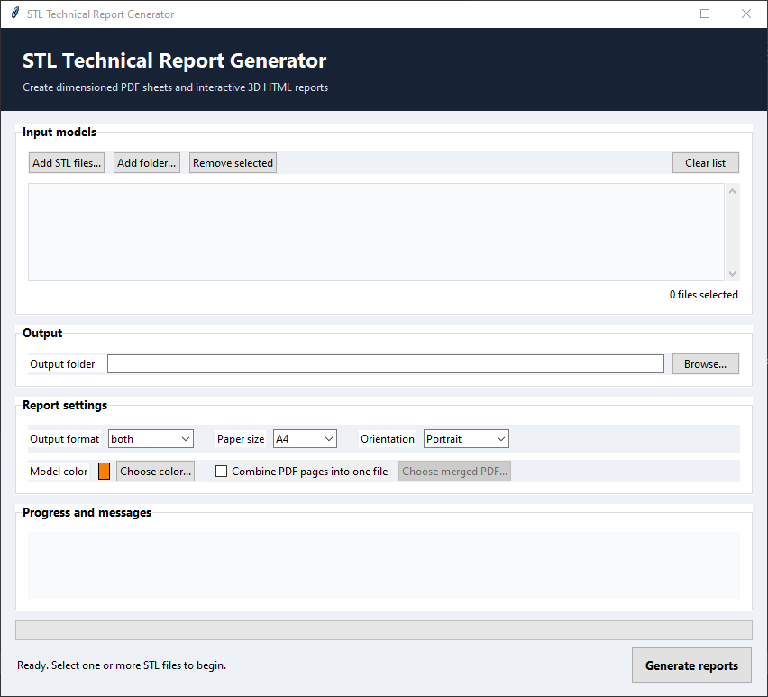

# stl2pdf

Generate dimensioned technical reports from STL models: a printable **PDF** sheet, an **interactive 3D HTML** report, or both. Includes a desktop GUI and a command-line interface.




## Features

- PDF sheet with four views (three axonometric views plus one extra angle), overall dimensions, bounds, triangle/vertex counts, connected components, surface area, and volume.
- Self-contained interactive HTML report (Plotly.js is embedded, so it works offline) with four interactive 3D views (orthographic projection) and the same metrics.
- Batch processing of single files or whole folders.
- Optional merge of all PDF pages into one multi-page PDF.
- Paper sizes A5, A4, A3, A1, portrait or landscape.
- Custom model color (the GUI remembers your last choice).
- Free and open-source dependencies only.

## Requirements

- Windows 10 or newer
- Python 3.9 or newer (the python.org installer includes Tkinter)

## Installation

```bat
git clone https://github.com/<your-user>/stl2pdf.git
cd stl2pdf
python -m venv .venv
.venv\Scripts\activate
pip install -r requirements.txt
```

## Usage

### GUI

Run the script without arguments:

```bat
python stl2pdf.py
```

Add files or a folder, choose the output folder, format, paper size, orientation, and color, then click **Generate reports**.

### Command line

```bat
python stl2pdf.py model.stl
python stl2pdf.py model.stl --format both --paper A3
python stl2pdf.py models\ --format html --paper A5 -o reports\
python stl2pdf.py model.stl --format pdf --paper A1 --landscape
python stl2pdf.py models\ --merge combined.pdf --paper A4
```

| Option | Description | Default |
| --- | --- | --- |
| `input` | An STL file or a directory containing STL files | required |
| `-o`, `--outdir` | Output directory | input directory |
| `--format` | `pdf`, `html`, or `both` | `both` |
| `--paper` | `A5`, `A4`, `A3`, or `A1` | `A4` |
| `--landscape` | Landscape orientation for the PDF | portrait |
| `--merge FILE.pdf` | Combine all models into one multi-page PDF | off |
| `--color` | Model color, e.g. `#4a90d9` | `#4a90d9` |

`--merge` requires PDF output. HTML reports are always written one per model.

## Output

For each `model.stl` the tool writes `model.pdf` and/or `model.html` to the output folder. The PDF contains a link to `model.html`; keep both files in the same folder for the link to work. With `--merge`, the PDF pages go into the single merged file instead, and the per-model link is not meaningful.

## How it works

- **Loading:** models are loaded with `trimesh`, vertices are merged, and face normals are fixed. Scenes with several meshes are concatenated.
- **PDF views:** rendered off-screen with VTK (through `pyvista`) using a real z-buffer, parallel projection, and smooth normals split on sharp edges (35 degrees). The images are placed on the page with `matplotlib`. Views are raster images; increase the render size in `render_view_images` for very large paper sizes.
- **HTML views:** drawn with Plotly `Mesh3d`. Shading is precomputed per vertex with two fixed lights and Plotly's own lighting is disabled, which avoids the shading artifacts Plotly produces on thin CAD triangles. The lights are fixed in model space and do not follow the camera.

## Notes

- STL files do not store a unit. All dimensions, areas, and volumes are reported in raw file units.
- Volume is computed only for watertight meshes.
- The last chosen model color is stored in `%APPDATA%\stl2pdf\settings.json`.

## Troubleshooting

- **Empty or black PDF views, or a crash only when generating from the GUI:** the GUI renders in a worker thread. Try the command-line mode with the same file, update your graphics drivers, and open an issue with the console output.
- **`pip install` fails on `vtk`/`pyvista`:** VTK wheels are not published for every Python version. Use a Python version supported by the current VTK release.
- **Large HTML files:** the mesh data is embedded once per view (four times). Heavy models produce large files.

## License

MIT. See [LICENSE](LICENSE).
